



 

## 🧑‍💻 Experience


 

## 💼 My Work

### 01 · CipherShield

A YOLO + OCR pipeline that finds PII on documents and masks it in real time (**<1.5 s**), with dashboards on top. **92–95% field accuracy · −80% manual redaction.** Ranked **13th in internal SIH** and **6th nationally (waitlisted) of 500+ teams**.

### 02 · AgriPrice-Forecast

A LightGBM forecaster for **50+ commodities**, with lag features built for non-contiguous time series and a Streamlit app that pulls live data over a REST API. **R² 0.935** on a strict temporal split.

### 03 · Automatic Essay Grading

BERT + LSTM scoring behind a Flask API that returns a grade, feedback and essay-quality metrics, plus dashboards that surface trends in student writing.

### 04 · CUMBH Crowd Analyzer

CSRNet estimates crowd density frame by frame and raises zone-level alerts before areas get dangerously packed, all on a real-time Streamlit dashboard.
→ [Source](https://github.com/Br4inhack/Crowd-Disaster-and-Management-System-CUMBH-)

### 05 · Mini-Aladdin

A continuous, risk-aware portfolio system where specialist agents score market, sentiment and fundamental risk and push live alerts. Built as a 5-person team.
→ [Source](https://github.com/Br4inhack/mini-aladdin)

 

## 🧰 Tech Stack


 

## 🏆 Highlights


 

## 🐍 Contribution snake

<picture>
  <source media="(prefers-color-scheme: dark)" srcset="https://raw.githubusercontent.com/Br4inhack/Br4inhack/output/snake-dark.svg">
  
</picture>

## 📫 Connect with me

<a href="https://github.com/Br4inhack?tab=repositories"></a>

